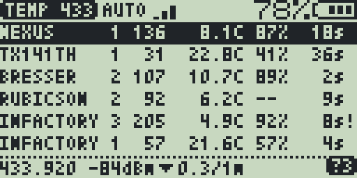
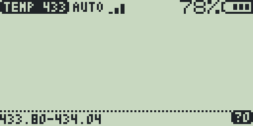
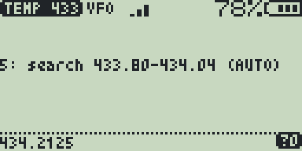

# Temp 433

[](https://github.com/Maciekbac/temp433/actions/workflows/build.yml)

A receive-only overlay app for the
[F4HWN firmware](https://github.com/armel/uv-k1-k5v3-firmware-custom) that reads
433 MHz wireless temperature sensors on the Quansheng UV-K1 and UV-K5 V3.



## Features

- Reads 11 kinds of 433 MHz thermometers and thermo-hygrometers (see
  [Supported sensors](#supported-sensors)).
- A table of up to 12 sensors: model, channel, ID, temperature, humidity, the
  time since the last reading, and a low battery mark.
- Searches the whole 433.80-434.04 MHz band (AUTO), or listens on the VFO
  frequency only.
- For the selected sensor: the frequency it is heard on, its signal level, and
  how its temperature changed over the last 10-20 minutes.
- Receive only: the app never transmits.

## Requirements

- A Quansheng UV-K1 or UV-K5 V3 with F4HWN Labs v6.3.0 or later, or a later
  edition with overlay apps (API level 3 or higher).
- Tested on a UV-K1 with F4HWN Labs v6.3.0.

## Install

1. Download `Temp433.app` from the
   [Releases](https://github.com/Maciekbac/temp433/releases) page.
2. In UV Studio, open Apps, connect the radio and install `Temp433.app` from a
   local file.
3. On the radio, open the Apps menu (`F` then `7`), select Temp 433 and press
   `MENU`.

## Quick start

**1. Start on 433.920 MHz.** Tune the VFO to 433.920 (any frequency from
433.80 to 434.04 MHz will do) and start the app. It starts in AUTO and sweeps
the whole band, because the sensors' frequencies spread up to ±75 kHz around
433.92.



Most sensors transmit every 30-90 seconds, so the first rows come after a
minute or two.

**2. Read the table.** Each heard sensor gets a row, in the order they were
first heard:


| Column | Example | Meaning |
|---|---|---|
| model | `INFACTORY` | the sensor type (see the table below) |
| channel | `3` | the channel switch of the sensor |
| ID | `205` | a code the sensor picks, often anew after a battery change |
| temperature | `4.9C` | °C |
| humidity | `92%` | `--` for sensors without one |
| age | `8s` | time since the last reading (`s`, `m`, `h`) |
| `!` | `8s!` | low battery |

Six rows show at a time; arrows in the status line mark more rows above or
below.

**3. Select a sensor.** UP and DOWN move the selection (the inverted row). The
bottom line shows that sensor's details:

```
433.920 -84dBm ▼0.3/1m      ?3
```

- `433.920`: the frequency it was last heard on.
- `-84dBm`: its signal level.
- `▼0.3/1m`: the temperature trend. The last reading is compared with one
  10-20 minutes older, or with the first one while the sensor has been heard
  for less than that: `▲` up, `▼` down, `=` no change, then the change in °C
  and over how long.
- The inverted `?3` at the right counts the packets no decoder recognised:
  sensors of other kinds, or damaged frames. It is a count for the whole app,
  not for the selected sensor.

**4. Listen on one frequency.** Started anywhere else on UHF, the app listens
on the VFO frequency only (VFO mode) and, until a sensor is heard, reminds you
that key `5` searches the whole band:



On VHF the app asks you to tune the VFO to 433.920 first.

## Keys

| Key | Action |
|---|---|
| UP / DOWN | select a sensor |
| 1 | speaker on / off (the sensor bursts are heard as buzzes) |
| 2 | clear the table and the `?` count |
| 3 | sensitivity: High (6 dB), Normal (10 dB), Low (15 dB) above the noise |
| 5 | AUTO (433.80-434.04 MHz) or the VFO frequency |
| EXIT | quit |

## Tips

- **Sensitivity.** The app always starts on High, which hears the weakest
  sensors. Normal and Low (key `3`, shown as 3, 2 or 1 bars) ignore weaker
  signals, which can help next to a strong source of interference.
- **A weak sensor.** In AUTO the app shares its time among 25 frequencies.
  If a distant sensor comes and goes, note its frequency in the bottom line,
  exit, tune the VFO exactly there and start the app again: in VFO mode it
  listens on that frequency all the time.
- **Unknown sensors.** If the `?` count grows while no row appears, a sensor
  of a kind the app does not read is probably nearby.

## Supported sensors

| Shown as | Protocol (rtl_433 decoder) | Also sold as |
|---|---|---|
| NEXUS | Nexus-TH | Sencor, Solight TE82S, FreeTec NC-7345, TFA 30.3209 |
| RUBICSON | Rubicson-Temperature, Solight-TE44 | TFA 30.3197, inFactory PT-310, Solight TE44/TE66, EMOS E0107T |
| PROLOGUE | Prologue-TH | FreeTec NC-7104, NC-7159, ThermoPro TX-2 |
| GT-WT-02 | GT-WT02 | Globaltronics (Aldi), Lidl AURIO YJ-T12 |
| AUR-AHFL | Auriol-AHFL | Lidl Auriol AHFL 433 B2 |
| AUR-AFW2 | Auriol-AFW2A1 | Lidl Auriol AFW 2 A1 |
| AUR-HG02 | Auriol-HG02832 | Lidl Auriol HG02832, HG05124A, Rubicson 48957 |
| INFACTORY | inFactory-TH | nor-tec, FreeTec NC-3982 |
| TX141TH | LaCrosse-TX141THBv2 | TFA 30.3221 |
| BRESSER | Bresser-3CH | Renkforce DM-7511 |
| EMOS | EMOS-E6016, EMOS-E6018 | |

Not supported: 868 MHz sensors, Manchester-coded ones (Oregon Scientific,
Hideki, Ambient Weather F007TH), AlectoV1, Esperanza EWS and La Crosse TX3.

The frame formats come from the device notes of
[rtl_433](https://github.com/merbanan/rtl_433), thanks to its authors.
Channels and IDs are shown the way rtl_433 shows them, so the two can be
compared side by side.

## Limitations

- A humidity outside 1-100 % shows as `--` (rtl_433 drops such a frame).
- Temperatures outside -40 to 70 °C are dropped as misreadings.
- GT-WT-02 humidity codes 10 and 110, which rtl_433 shows as 0 % and 100 %,
  show as `10%` and `--`.
- Nexus, Prologue and Auriol AFW 2 A1 send no checksum: a reading counts once
  the same frame comes twice.
- The table keeps 12 sensors; a new one then replaces the one heard longest
  ago. The table is not kept after the app exits.

## How it works

The radio's receiver runs in AM with its audio filters bypassed and a fixed
gain, so its audio output is the on/off envelope of the sensor bursts. In AUTO
the app steps through 433.80-434.04 MHz in 10 kHz steps, visiting 433.92 at
every other step, and keeps a noise level for each frequency. A reading the
chosen sensitivity above that noise starts a capture: the audio is sampled at
20 kHz until it goes quiet. The capture is cut into pulses and gaps, decoded
as pulse-position (PPM) or pulse-width (PWM) bits, and matched against a table
of protocols. One loop runs every checksum of the table: nibble and byte sums,
CRC-4, CRC-8 and the LFSR digest.

## Build

To build: `arm-none-eabi-gcc` on the `PATH`, Python 3 and bash.

```sh
python3 tools/fetch_sdk.py   # downloads the F4HWN app SDK into sdk/
./build.sh                   # writes Temp433.app
```

Set `PYTHON` if your Python 3 is not called `python3`, for example
`PYTHON=python ./build.sh`.

The folder can also be copied to `App/apps/temp433/` in the firmware tree. It
then builds with the firmware's own SDK, with `./compile-app.sh temp433` from
the firmware root.

## License

Apache License 2.0, see [LICENSE](LICENSE) and [NOTICE](NOTICE). The app is
built against the overlay-app SDK of the F4HWN firmware, and the speaker and
scroll-mark bitmaps of the status line come from the F4HWN apps FoxHunt and
AIS RX; NOTICE has the details.
